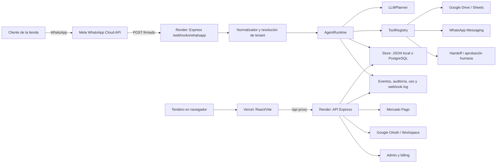
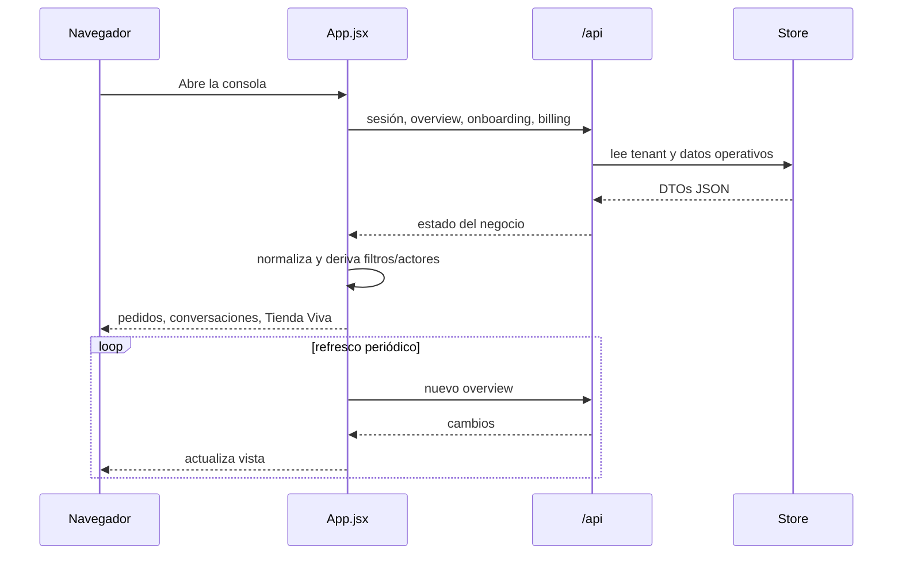
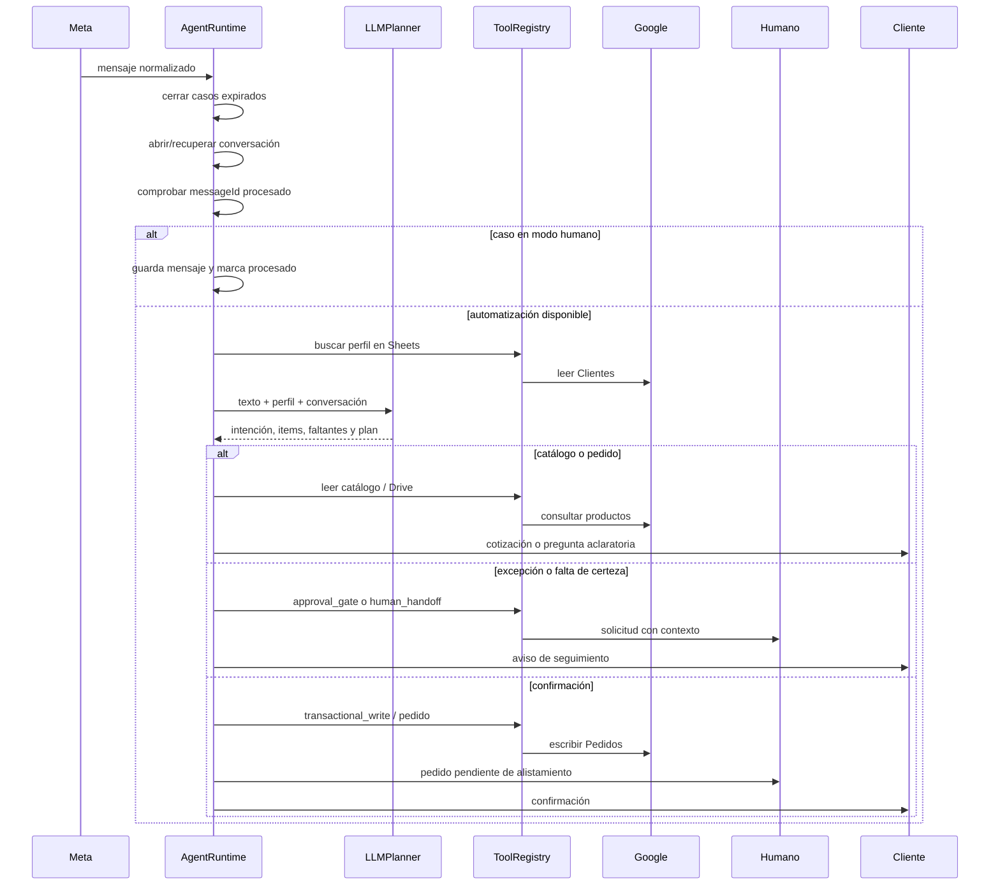

# Arquitectura profunda de la app y del agente

**Fecha de revisión:** 17 de octubre de 2026
**Alcance:** frontend React/Vite, backend Express, runtime del agente, persistencia, integraciones, seguridad, operación y despliegue.
**Fuente:** código ejecutable del repositorio, migraciones SQL, configuración y pruebas existentes. Los documentos de producto se usan únicamente como contexto.

El plan ejecutable para cerrar los riesgos y deudas identificados está en [Plan detallado para cerrar los hallazgos de arquitectura](./Plan-cierre-hallazgos-arquitectura.md).

Este documento describe cómo funciona hoy la plataforma, dónde están sus límites y cuál es la evolución recomendada. No sustituye los manuales de usuario ni el documento de funcionamiento real; sirve como guía técnica para mantener, probar y ampliar el producto sin romper la operación del tendero.

## 1. Resumen ejecutivo

Ventas IA es un SaaS multitienda que recibe conversaciones de WhatsApp, consulta el catálogo y los datos de clientes de la tienda, interpreta la intención con un planificador LLM y decide si puede responder, preparar un pedido o pedir intervención humana. El tendero opera desde una consola React que muestra conversaciones, pedidos, solicitudes pendientes, la Tienda Viva, configuración y consumo.

La solución actual es un **monolito modular** en dos procesos:

- **Frontend:** una aplicación React/Vite desplegada en Vercel. `src/App.jsx` concentra la navegación, buena parte del estado, las llamadas HTTP y varias vistas operativas.
- **Backend/agente:** una aplicación Express desplegada en Render. `server/index.js` compone almacenamiento, autenticación, eventos, uso, integraciones, planificador y runtime del agente.

Este enfoque es adecuado para el piloto y reduce el número de servicios que el equipo debe operar. La principal deuda no está en la cantidad de servicios sino en los límites internos: el frontend es demasiado grande, los contratos HTTP no están tipados de forma central, el agente combina orquestación y efectos secundarios, y PostgreSQL conserva simultáneamente un snapshot JSONB y tablas espejo.

Los dos riesgos que deben atenderse antes de crecer el número de tiendas son:

1. **Estados de pedido incompatibles entre la app y Google Sheets.** La app usa `pending_human_preparation`, `preparing`, `dispatched`, `delivered` y `cancelled`; las reglas de validación de la hoja usan `draft`, `confirmado`, `preparando`, `entregado` y `cancelado`. La sincronización puede escribir un valor que la hoja no espera.
2. **Actualizaciones distribuidas sin una transacción de dominio.** Confirmar un pedido cambia pedido, conversación, solicitud humana, eventos, uso, WhatsApp y Google Sheets. Muchos `persist...` se encolan sin ser esperados por el flujo que los inició. Un fallo intermedio puede dejar una parte de la operación guardada y otra pendiente.

La recomendación es evolucionar por contratos y fronteras, sin reemplazar el backend: primero unificar estados e idempotencia; después extraer el frontend por capacidades y centralizar el cliente API; finalmente operar las proyecciones externas mediante un outbox durable y workers controlados.

## 2. Mapa de ejecución



### 2.1 Arranque del backend

`server/index.js` crea el runtime en este orden lógico:

1. Selecciona `JsonStore` o `PostgresStore` según `STORAGE_DRIVER` o `DATABASE_URL`.
2. Carga y migra el estado persistido.
3. Construye `EventService`, `UsageService`, `SecretVault` y `GoogleWorkspaceService`.
4. Construye `ToolRegistry`, `LLMPlanner` y `AgentRuntime`.
5. Construye `SaasControlPlane` y `AuthService`.
6. Monta middleware de CORS, JSON con captura de `rawBody`, sesión y CSRF.
7. Monta las rutas de autenticación, billing, SaaS, administración, API y webhooks.
8. Sirve `dist` como fallback SPA cuando el backend también contiene el build.

El runtime inicia además un barrido periódico de casos humanos inactivos. El intervalo y la ventana de inactividad son configurables en `server/config.js`.

### 2.2 Despliegue actual

| Capa | Ubicación | Responsabilidad | Dependencia principal |
| --- | --- | --- | --- |
| Landing y consola | Vercel | Entregar el bundle React y proxy `/api` | Variables públicas del frontend |
| API y agente | Render | HTTP, webhooks, agente, SaaS y administración | PostgreSQL/Supabase, Meta, Google, Mercado Pago, LLM |
| Datos | PostgreSQL en producción; JSON local | Estado de tenants, conversaciones, pedidos, eventos y uso | `DATABASE_URL` |
| Catálogo operativo | Google Sheets/Drive | Productos, archivos, clientes y pedidos sincronizados | OAuth y conexión por tenant |
| Mensajería | Meta WhatsApp Cloud API | Entradas y respuestas al cliente | webhook, token, firma y número vinculado |
| Cobros | Mercado Pago | Suscripción, checkout y webhooks | credenciales y firma configuradas |

El proxy local de Vite redirige `/api`, `/webhooks` y `/health` a `127.0.0.1:3001`. En producción el navegador conserva el mismo contrato relativo y Vercel lo envía al backend.

## 3. Arquitectura del frontend

### 3.1 Composición actual

`src/main.jsx` monta `App` dentro de `React.StrictMode`. `App.jsx` actúa como shell, controlador de navegación y contenedor de casi todas las capacidades:

- autenticación y sesión;
- selección de tenant;
- lectura periódica de resumen operativo, conversaciones, eventos y solicitudes;
- onboarding y conexión de servicios;
- bandeja de pedidos y pendientes;
- conversaciones y respuestas;
- Tienda Viva;
- analítica, uso, configuración y vistas de administrador;
- estados de carga, error, vacío, avisos y acciones de mutación.

La landing pública está separada en `src/components/LandingPage.jsx`, pero las vistas autenticadas todavía viven principalmente en el módulo raíz. `src/styles.css` concentra gran parte del estilo global y el responsive.

La navegación se resuelve con query string y pathname (`?app=1`, `?view=...` y rutas legales), no con un router declarativo. Esto funciona para el flujo actual, pero hace que permisos, enlaces profundos, historial y carga diferida dependan de condicionales dentro del componente principal.

### 3.2 Flujo de datos del dashboard



El frontend mantiene mucho estado con `useState` y coordina lecturas con `useEffect` y `fetch`. El estado de servidor y el estado visual se almacenan en el mismo módulo, por lo que una mutación puede requerir recordar manualmente qué listas refrescar y qué selección conservar.

### 3.3 Qué está bien resuelto

- La navegación principal usa lenguaje de operación: **Hoy**, **Pedidos y pendientes**, **Conversaciones**, **Tienda Viva** y **Poner en marcha**.
- La consola distingue datos reales de fixtures y evita presentar pedidos ficticios cuando el backend conectado está vacío.
- Los botones de la cola siguen el ciclo operativo: tomar, poner en camino y entregar.
- La Tienda Viva se alimenta de conversaciones y pedidos actuales; los personajes representan actividad y abren el caso correspondiente.
- La landing, la consola y los manuales ya comparten un lenguaje simple para el tendero.

### 3.4 Problemas y límites

| Hallazgo | Evidencia | Impacto |
| --- | --- | --- |
| `App.jsx` es un monolito de aproximadamente 284 KB | Módulo raíz con vistas, fetch y mutaciones | Cambios pequeños tienen alto riesgo de regresión y dificultan pruebas aisladas |
| `styles.css` es un bloque global de aproximadamente 168 KB | Hoja global única | Colisiones, reglas difíciles de localizar y mayor coste de mantenimiento |
| No hay cliente API ni DTOs centrales | Llamadas `fetch` y formas de respuesta repartidas en `App.jsx` | Contratos duplicados y errores silenciosos cuando cambia el backend |
| No hay una capa explícita de estado de servidor | `useEffect` + `useState` para lecturas y refrescos | Refetch manual, estados obsoletos y lógica de caché repetida |
| El routing depende de condicionales | `pathname`, `searchParams` y `activeView` | Deep links y permisos más difíciles de razonar |
| Bundle sin separación por capacidad | Un entry principal con todas las vistas | Más JavaScript inicial y menor aislamiento de errores |

### 3.5 Arquitectura frontend objetivo

La siguiente estructura permite migrar por partes sin cambiar las URLs del backend:

```text
src/
  app/
    AppShell.jsx
    routes.js
    session.js
  core/
    api/client.js
    api/contracts.js
    query/refreshPolicy.js
    errors/normalizeError.js
  domain/
    orders/status.js
    conversations/status.js
    tenants/permissions.js
  features/
    onboarding/
    orders/
    conversations/
    live-store/
    analytics/
    settings/
    admin/
  shared/
    components/
    feedback/
    formatters/
    design-tokens.css
```

La migración puede comenzar extrayendo una capacidad por vez. Cada feature debe recibir datos y callbacks explícitos; el shell no debe conocer los detalles de una tarjeta de pedido ni de una conversación. El cliente API debe centralizar `fetch`, CSRF, errores, timeout, autenticación y normalización de fechas.

## 4. Arquitectura del agente

### 4.1 Entrada de WhatsApp

`server/routes/whatsapp.js` implementa el contrato de Meta:

1. Responde el challenge `GET` con el token de verificación.
2. Captura el cuerpo crudo para validar `X-Hub-Signature-256`.
3. Normaliza mensajes y estados de entrega.
4. Resuelve el tenant por `phone_number_id`.
5. Rechaza tenants no operativos.
6. Delega en `AgentRuntime.processInbound`.
7. Registra resultado, duplicados, duración y errores en `webhook_events`.

Los mensajes de texto, imagen y estados de entrega se convierten en un contrato interno común. El mismo runtime recibe actualmente `delivery_status`; debe mantenerse explícita la separación entre eventos de conversación y eventos de transporte para no interpretar una confirmación de Meta como una nueva intención del cliente.

### 4.2 Pipeline de `AgentRuntime`



El método `routeConversation` sigue esta secuencia conceptual:

1. buscar perfil del cliente;
2. pedir al `LLMPlanner` una salida estructurada;
3. guardar el plan y el progreso de la conversación;
4. escalar si Google no está conectado para una intención que depende del catálogo;
5. escalar imágenes, solicitudes explícitas de humano, descuentos o pagos;
6. atender confirmación, aclaración, pedido a domicilio o consulta de catálogo;
7. registrar herramientas, uso y eventos.

### 4.3 Planificador LLM

`server/services/llmPlanner.js` es un adaptador de proveedores y modos de ejecución. Puede usar DeepSeek, Gemini, el simulador Codex para pruebas o el parser determinista local. La salida esperada incluye intención, pedido, herramientas recomendadas, faltantes, confianza y estrategia de respuesta.

El fallback en español colombiano es útil para pruebas y continuidad controlada, pero no debe confundirse con un modelo productivo. Debe quedar visible en observabilidad qué proveedor y modo produjeron cada plan. Los planes deben validarse contra un esquema antes de que el runtime ejecute una herramienta.

### 4.4 Registro de herramientas

`ToolRegistry` es la frontera única de efectos externos. Actualmente agrupa:

- lectura de catálogo y perfil en Sheets;
- selector de archivos de Drive;
- escritura de clientes y pedidos;
- sincronización de estado de pedido;
- aprobación y escalamiento humano;
- mensajería de WhatsApp;
- escritura transaccional y consumo.

Cada llamada genera eventos `tool.call.started`, `tool.call.completed` o `tool.call.failed` y puede actualizar uso. La frontera es valiosa, pero el registro aún combina selección de proveedor, transformación de payload, persistencia y reglas de negocio. La siguiente evolución debe separar adaptadores (`GoogleCatalogAdapter`, `WhatsAppAdapter`, `BillingAdapter`) de políticas del agente.

### 4.5 Human-in-the-loop

El agente no intenta resolver excepciones con certeza insuficiente. `human_handoff` crea una solicitud con equipo, urgencia, motivo y contexto. El operador responde, aprueba, toma el pedido o lo rechaza desde la consola. Al resolver un pedido, el runtime sincroniza Google antes de cambiar el estado local cuando la conexión está disponible.

Este patrón es el diferenciador operativo del producto: la automatización prepara la conversación y el contexto; la persona conserva las decisiones que afectan precio, disponibilidad, pago o entrega.

## 5. Modelo de dominio y estados

| Entidad | Identificador | Responsabilidad | Consumidores |
| --- | --- | --- | --- |
| Tenant | `tenant.id` | Tienda, configuración y conexiones | auth, agente, billing, UI |
| Membership | usuario + tenant | Rol `owner`, `operator` o `viewer` | AuthService, navegación |
| Conversation | `conversation.id` | Caso de WhatsApp, mensajes y progreso | runtime, cola, Tienda Viva |
| Message | `message.id` o `messageId` Meta | Entrada/salida trazable e idempotencia | webhook, conversación |
| Order | `order.id` | Canasta, dirección, estado y trazabilidad | cola, Sheets, WhatsApp |
| PendingRequest | `pendingRequest.id` | Aprobación o intervención humana | operador, runtime |
| Event | `event.id` | Auditoría y observabilidad | admin, soporte |
| Usage | tenant + periodo + métrica | Límites y facturación | planner, tools, billing |
| Connection | tenant + proveedor | Estado de Google/WhatsApp | onboarding, tools |
| Subscription | tenant + ciclo | Plan y acceso operativo | SaaS, billing |

### 5.1 Estado de conversación

La conversación se mueve entre estados como `live`, `blocked`, `manual_active`, `needs_binding`, `degraded`, `completed` y `closed_no_confirmation`. Además conserva `stage`, `zone`, `progress`, `nextStep`, `reasoningPlan` y `orderDraft`. Estos campos mezclan estado de negocio, presentación y diagnóstico; conviene mantenerlos compatibles, pero distinguir en el modelo futuro:

- `lifecycleStatus`: estado de negocio;
- `attentionReason`: por qué requiere atención;
- `progress`: indicador visual derivado;
- `lastAction` y `nextAction`: guía operativa.

### 5.2 Estado de pedido

El contrato de la API valida esta ruta:

```text
pending_human_preparation -> preparing -> dispatched -> delivered
```

También existe la salida `cancelled`. La hoja de cálculo usa valores en español y agrega valores de borrador/confirmado. Esta duplicidad debe corregirse con un enum canónico interno y un adaptador explícito para cada sistema externo:

| Estado canónico | Google Sheets actual | Texto para el tendero |
| --- | --- | --- |
| `pending_human_preparation` | `confirmado` | Pendiente de alistar |
| `preparing` | `preparando` | En preparación |
| `dispatched` | `en_camino` o `despachado` | En camino |
| `delivered` | `entregado` | Entregado |
| `cancelled` | `cancelado` | Cancelado |

La tabla anterior es una propuesta de compatibilidad; debe aprobarse antes de migrar datos existentes. La API no debería exponer el valor de Sheets como si fuera el contrato de dominio.

## 6. Persistencia y consistencia

### 6.1 JSON local

`JsonStore` carga `server/data/runtime-store.json`, fusiona semillas y guarda el documento después de cada mutación. Es adecuado para desarrollo, demos y pruebas unitarias, pero no ofrece concurrencia entre procesos, recuperación ante escritura parcial ni garantías de durabilidad equivalentes a PostgreSQL.

### 6.2 PostgreSQL

`PostgresStore` mantiene:

1. un documento completo en `app_state.document` como snapshot JSONB;
2. tablas espejo para tenants, conversaciones, pedidos, eventos, solicitudes, perfiles, uso, webhooks y otras entidades;
3. una cola de escrituras (`saveQueue`) para serializar operaciones.

Las lecturas de listas importantes usan las tablas SQL, mientras que varias mutaciones y funciones de runtime leen `getState()` en memoria. `mutate` actualiza memoria y encola el snapshot; `persistOrder`, `persistConversation` y otros métodos encolan upserts individuales. En distintos puntos del agente se invocan sin `await`.

Esto permite avanzar rápido, pero crea tres fuentes de riesgo:

- una lectura puede ver la tabla espejo antes o después del snapshot;
- una promesa fallida queda registrada en consola y el flujo HTTP ya puede haber terminado;
- dos operaciones relacionadas pueden llegar a la base en momentos distintos y quedar parcialmente aplicadas.

### 6.3 Evolución recomendada de consistencia

Sin cambiar el almacenamiento de inmediato:

1. definir una operación `OrderService.transition()` que valide transición, actualice pedido, solicitud, conversación y auditoría en una unidad lógica;
2. hacer que el caller espere el resultado de persistencia cuando la respuesta depende de él;
3. agregar claves únicas y upsert atómico para `messageId`, `orderId` y `idempotencyKey`;
4. publicar eventos de integración después de persistir el cambio de dominio;
5. medir `write_lag_ms` y errores de la cola;
6. cuando el volumen lo justifique, retirar el snapshot como fuente de negocio y conservarlo solo como exportación o caché.

## 7. Seguridad y aislamiento

### Capacidades existentes

- sesión HTTP con cookie `httpOnly`;
- token CSRF para métodos inseguros cuando está habilitado;
- membresías y roles por tenant;
- autorización de rutas y administrador de plataforma;
- verificación HMAC del webhook de Meta cuando existe app secret;
- referencias de secretos mediante `SecretVault`;
- auditoría de eventos administrativos y de proveedor.

### Riesgos a cerrar

| Prioridad | Riesgo | Acción |
| --- | --- | --- |
| P1 | `cors()` se monta sin una lista de orígenes explícita | Permitir solo el dominio de la app y orígenes de desarrollo conocidos |
| P1 | `allowDevGoogleLogin` se activa por defecto si no existe `GOOGLE_CLIENT_ID` | Fallar el arranque en producción si auth real, client ID o secreto no están completos |
| P1 | El modo de WhatsApp y el fallback de catálogo tienen defaults de desarrollo | Validar configuración de producción durante el arranque y mostrar estado bloqueante en onboarding |
| P1 | Payloads de webhook y contexto del cliente pueden terminar en logs/eventos | Redactar tokens, teléfonos completos y contenido sensible según política de retención |
| P2 | No hay correlación uniforme en cada llamada | Propagar `requestId`, `messageId`, `conversationId`, `orderId` y `tenantId` en logs y eventos |

## 8. Observabilidad y operación

La plataforma ya registra eventos de agente, herramientas, decisiones, uso y webhooks. El administrador puede consultar webhooks y eventos recientes. Sin embargo, el modelo actual es principalmente de auditoría; falta una traza de una operación completa.

El mínimo recomendado es que cada entrada tenga:

```text
traceId
tenantId
providerEventId
messageId
conversationId
orderId
toolCallId
startedAt / finishedAt
status
errorCode
```

Con esos campos, soporte puede responder “qué pasó con este pedido” sin unir manualmente registros por timestamps. Los errores de proveedor deben conservar código estable, mensaje seguro para el usuario y detalle técnico separado.

## 9. Pruebas actuales y huecos

El repositorio tiene smoke tests de backend, escenarios colombianos, autenticación, proveedores LLM, Google, WhatsApp, Embedded Signup, PostgreSQL y pruebas de UI/landing. Es una base útil para el piloto.

Faltan pruebas de contrato y concurrencia en estos puntos:

- contrato único de estados entre API, frontend y Google Sheets;
- dos webhooks simultáneos con el mismo `messageId`;
- dos operadores intentando tomar o avanzar el mismo pedido;
- fallo después de escribir Sheets y antes de guardar conversación;
- reintento de WhatsApp cuando el proveedor responde timeout;
- recuperación de la cola de persistencia después de una desconexión de PostgreSQL;
- DTOs de `GET /api/ops/overview` y `PATCH /api/orders/:id/status` contra fixtures de producción;
- permisos de cada rol sobre cada acción de la cola.

## 10. Plan de evolución priorizado

### P0 — proteger la operación

1. Adoptar el enum canónico de pedido y un adaptador para Sheets.
2. Crear `OrderService.transition()` y reutilizarlo desde la API y la resolución humana.
3. Hacer atómica la deduplicación de mensajes en PostgreSQL.
4. Validar configuración de producción al arrancar: auth, CORS, WhatsApp, Google y proveedor LLM.
5. Añadir `traceId` y correlación de pedido a eventos y webhooks.

**Criterio de aceptación:** un pedido no puede saltar estados, duplicarse ni quedar con conversación y hoja en estados incompatibles; un fallo deja una alerta operable y un código trazable.

### P1 — reducir complejidad del frontend

1. Extraer `core/api/client.js` y contratos de respuesta.
2. Extraer features de pedidos, conversaciones, onboarding y Tienda Viva.
3. Definir permisos y navegación en una sola configuración.
4. Separar estado de servidor de estado visual y normalizar loading/error/empty/success.
5. Cargar vistas pesadas de forma diferida y dividir estilos por feature.

**Criterio de aceptación:** cada capacidad puede probarse y cambiarse sin editar el shell; una respuesta inválida muestra un error claro y no rompe toda la consola.

### P2 — hacer observable el ciclo completo

1. Añadir una vista de trazabilidad por pedido.
2. Medir latencia por herramienta, proveedor y etapa.
3. Añadir reintentos seguros con idempotencia para integraciones.
4. Separar adaptadores externos de reglas del agente.

**Criterio de aceptación:** soporte puede reconstruir el camino de un pedido desde WhatsApp hasta entrega con un `traceId`.

### P3 — preparar crecimiento

1. Definir límites de cola y backpressure para webhooks.
2. Mover tareas largas a un worker cuando el tráfico lo requiera.
3. Retirar el snapshot JSONB como fuente primaria de lectura.
4. Versionar contratos y migraciones de datos externos.

**Criterio de aceptación:** el crecimiento de tenants no aumenta de forma lineal la complejidad del proceso HTTP ni el riesgo de perder eventos.

## 11. Recomendación de decisión

La arquitectura actual puede seguir soportando el primer segmento de tiendas de barrio si se mantiene el alcance y se corrigen primero los estados de pedido, la consistencia de escritura y las guardas de producción. No conviene dividir el backend en microservicios todavía: el coste de operación sería mayor que el beneficio. El siguiente salto de calidad debe darse dentro de los módulos existentes, con contratos explícitos y un servicio de pedidos que concentre las reglas críticas.

La Tienda Viva debe seguir consumiendo los mismos estados canónicos que la cola de pedidos. Así deja de ser una ilustración independiente: cada personaje, movimiento o alerta representa una conversación, un pedido o una intervención que el tendero puede abrir y resolver.

## 12. Estado de implementación de esta revisión

La primera ejecución del plan ya incorporó el contrato canónico de pedidos, `OrderService`, deduplicación atómica de mensajes, validación fail-closed de producción, CORS restringido, `health/ready`, correlación `x-request-id`/`traceId`, cliente API frontend, normalización de contratos, extracción inicial de pedidos y una outbox durable para proyecciones de Google Sheets. También se añadieron pruebas de contrato, reintento de outbox, carrera de transición y smoke test contra PostgreSQL local real.

La outbox se activa de forma opt-in con `INTEGRATION_OUTBOX_ENABLED=true`. La protección de carrera cubre las transiciones concurrentes dentro de una instancia; para múltiples instancias queda pendiente una condición de versión transaccional en PostgreSQL. También quedan pendientes la migración auditada de valores históricos de Sheets, retirar gradualmente `app_state` como fuente operativa y terminar la extracción de las demás features del frontend.

## 13. Referencias del repositorio

- [Arquitectura y funcionamiento real](./Arquitectura-y-funcionamiento-real-Ventas-IA.md)
- [Backend y contratos HTTP](../BACKEND.md)
- [Revisión integral UX del tendero](./Revision-integral-UX-tendero-2026-10-17.md)
- [Manuales de usuario](./Manuales-de-usuario.md)
- [Proceso de commit, push y despliegue](./Proceso-commit-push-despliegue.md)
