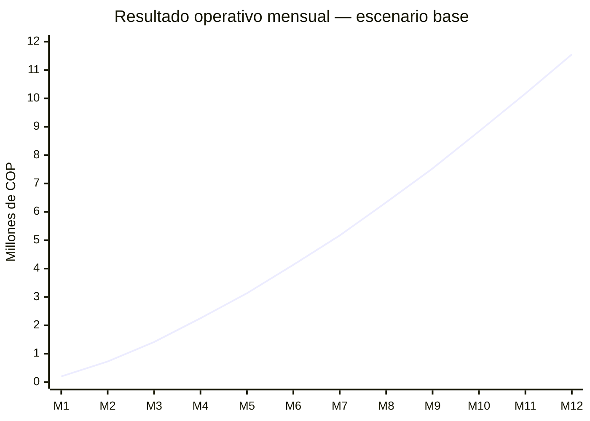

# Propuesta comercial y caso de negocio — Ventas IA

**Versión:** 15 de octubre de 2026
**Alcance:** Bogotá durante los primeros seis meses y expansión progresiva a Medellín, Cali, Bucaramanga y Barranquilla.

## Resumen ejecutivo

Ventas IA atiende una necesidad concreta: organizar pedidos que hoy llegan por WhatsApp, consultar el catálogo real de la tienda, pedir los datos faltantes y entregar al tendero una orden clara cuando se requiere intervención humana.

La oportunidad existe porque el comercio de barrio es numeroso y WhatsApp ya es el canal empresarial dominante. La barrera principal es la disposición a pagar: muchas empresas usan WhatsApp sin pagar por software. La venta debe demostrar ahorro de tiempo, menos pedidos perdidos y una operación de domicilios más ordenada.

El escenario base contempla dos vendedores en Bogotá con remuneración 100 % variable, adquisición digital autoservicio, precio de COP 89.000 mensuales, churn mensual del 5 % y costo técnico de COP 19.000 por cliente activo. Con esos supuestos se llega a **208 clientes activos en Bogotá al mes 12**, COP 102,9 millones de ingresos anuales y COP 61,4 millones de resultado operativo acumulado antes de soporte, impuestos, administración y otros gastos no modelados. Una proyección nacional separada agrega adquisición digital escalonada en cuatro ciudades desde el mes 7.

**Decisión propuesta:** ejecutar un piloto comercial de 90 días en Bogotá, con dos vendedores a comisión y adquisición digital controlada. El piloto debe validar activación, retención, costo de adquisición y disposición real a pagar antes de acelerar la expansión nacional.

## Evidencia de mercado

- DANE estimó 540.233 micronegocios de panaderías y tiendas de barrio en Colombia en 2024. El 88,4 % de los propietarios trabajaba por cuenta propia, lo que indica un mercado amplio pero sensible al precio y a la complejidad de implementación. [DANE — EMICRON, panaderías y tiendas de barrio](https://www.dane.gov.co/index.php/estadisticas-por-tema/mercado-laboral/micronegocios).
- En 2025, el 94 % de las empresas declaró usar WhatsApp o WhatsApp Empresarial para mensajería; entre empresas pequeñas la cifra fue 95 %. El 58,9 % del gasto en WhatsApp empresarial se destinó a comunicación con clientes. [Postdata — Informe empresarial 2025](https://www.postdata.gov.co/sites/default/files/story/Informe_EMPRESARIAL_v3.pdf).
- El mismo informe muestra una limitación comercial: el 74 % de las empresas que usan aplicaciones de mensajería declara no pagar por ninguna. Ventas IA debe vender un resultado económico y operativo, no solamente acceso a un bot. [Postdata — Informe empresarial 2025](https://www.postdata.gov.co/sites/default/files/story/Informe_EMPRESARIAL_v3.pdf).
- La Cámara de Comercio de Bogotá anunció 50.000 asesorías a comerciantes en 2024 y reportó 5.442 soluciones digitales implementadas en 2023. Esto confirma interés institucional y empresarial por digitalizar pequeños negocios. [CCB — Así acompaña la CCB al comerciante](https://www.ccb.org.co/blog/asi-acompana-al-comerciante).
- Como referencia de escala, una estimación anterior de la CCB identificó 671.154 micronegocios en Bogotá y 119.982 unidades con potencial de intervención. El dato de potencial procede de información de 2020 y debe usarse como referencia, no como medición actual del mercado. [CCB — Estimación del potencial de comerciantes](https://bibliotecadigital.ccb.org.co/bitstreams/c378c4ce-f04e-4abd-88f4-06e8407d79a2/download).

### Tamaño de oportunidad

Para dimensionar la oportunidad se usa el precio propuesto de COP 89.000 mensuales y se distingue entre mercado total, mercado atendible y objetivo del primer año:

| Nivel | Referencia | Cálculo orientativo | Valor anual potencial |
|---|---|---:|---:|
| TAM Colombia | 540.233 panaderías y tiendas de barrio | 540.233 × COP 1.068.000 | COP 576,7 mil millones |
| SAM Bogotá | 119.982 unidades con potencial de intervención según referencia CCB | 119.982 × COP 1.068.000 | COP 128,1 mil millones |
| SOM objetivo año 1 | 208 clientes activos al mes 12 en el escenario base | 208 × COP 1.068.000 | COP 222,1 millones de ingreso anualizado al ritmo del mes 12 |

El TAM y el SAM son magnitudes de oportunidad, no una previsión de ventas. El SOM de 208 clientes equivale a cerca de 0,17 % de la referencia SAM de Bogotá, por lo que la hipótesis de primer año es pequeña frente al universo disponible.

### Necesidad y ventana de adopción

La necesidad no es crear otro canal de mensajería. Es reducir el trabajo manual que aparece cuando una tienda recibe pedidos, consultas de catálogo, datos incompletos, comprobantes de pago, reclamos e imágenes por WhatsApp. El repositorio confirma que el producto puede consultar el catálogo de la tienda, conservar el perfil del cliente, preparar un pedido y escalar a una persona cuando falta certeza.

La ventana de adopción tiene dos caras. WhatsApp ya está instalado en la operación empresarial, pero una proporción importante de empresas no paga por aplicaciones de mensajería. Por eso la venta debe demostrar un resultado observable: menos tiempo contestando, menos pedidos perdidos, mayor trazabilidad y una orden lista para alistar. El producto debe venderse como operación asistida, no como un bot genérico.

### Alternativas del cliente y posicionamiento

| Alternativa | Ventaja para la tienda | Limitación que Ventas IA aborda |
|---|---|---|
| WhatsApp manual | No exige cambio de herramienta | Consume tiempo, mezcla conversaciones y no deja un pedido estructurado |
| Catálogo de WhatsApp Business | Fácil de empezar | No organiza por sí solo datos faltantes, confirmaciones y alistamiento |
| Chatbot genérico | Automatiza respuestas repetitivas | Puede responder sin validar catálogo, stock, pago o contexto de la tienda |
| POS o plataforma de domicilios | Puede ordenar venta y entrega | Puede requerir migración, comisiones o una operación más compleja |
| Ventas IA | Automatiza consultas y conserva control humano | Requiere onboarding de catálogo, Google y WhatsApp |

El posicionamiento recomendado es: **“Ventas IA organiza los pedidos de WhatsApp de tu tienda, consulta tu catálogo y entrega al tendero una orden clara para preparar y despachar.”**

## Cliente objetivo y propuesta

El primer segmento debe ser una tienda o minimercado que:

- recibe pedidos diarios por WhatsApp;
- vende con domicilio o está intentando organizarlo;
- tiene clientes recurrentes y un catálogo que puede llevarse a Sheets;
- pierde tiempo contestando preguntas repetitivas;
- necesita que una persona conserve el control sobre stock, descuentos, pagos, reclamos y entregas.

La propuesta comercial es: **“Ventas IA organiza los pedidos de WhatsApp de tu tienda, consulta tu catálogo y entrega al tendero una orden clara para preparar y despachar.”**

El producto no debe posicionarse como autonomía total. Su ventaja es combinar respuestas automáticas, consulta de fuentes de la tienda, trazabilidad y escalamiento humano.

## Propuesta de valor y operación

La tienda conserva el control sobre precio, inventario, pagos, descuentos, reclamos y entrega. Ventas IA se encarga de ordenar la conversación y preparar el siguiente paso:

1. El cliente escribe por WhatsApp.
2. El sistema identifica la tienda y consulta el catálogo y el perfil disponible.
3. Pregunta por presentación, cantidad, dirección u otro dato faltante.
4. Calcula y presenta el pedido para confirmación.
5. Guarda el pedido y entrega al tendero una tarea de alistamiento.
6. Escala imágenes, quejas, descuentos, pagos y casos ambiguos a una persona.

La activación de una tienda requiere suscripción, Google conectado, Drive y Sheets aprovisionados, configuración de DeepSeek y WhatsApp verificado. Esto debe tratarse como una etapa comercial medible, porque una suscripción sin activación no produce valor ni debe liberar toda la comisión.

## Modelo económico por suscripción

| Concepto | Supuesto base |
|---|---:|
| Precio mensual | COP 89.000 |
| Ingreso de un cliente durante 12 meses | COP 1.068.000 |
| Infraestructura + DeepSeek + Mercado Pago | COP 19.000 por cliente activo/mes |
| Comisión comercial | 20.000 / 10.000 / 9.000 durante 5 meses / 5.000 durante 5 meses |
| Comisión total máxima durante el primer año | COP 100.000 por cliente |
| CAC digital usado en la proyección | COP 120.000 |
| Vendedores | Remuneración 100 % variable, solo por comisión |

La comisión comercial equivale al 9,36 % de los ingresos del primer año por cliente vendido por un comercial. Se paga únicamente mientras esa suscripción esté cobrada y activa; las altas digitales no generan comisión de vendedor.

### Definición financiera

En esta propuesta, **resultado operativo** o **ingreso neto mensual** significa ingresos brutos por suscripciones menos infraestructura, DeepSeek, Mercado Pago, comisiones de vendedores y marketing digital. Es una contribución operativa antes de soporte, transporte, administración, impuestos, desarrollo, devoluciones y otros costos fijos o extraordinarios.

## Canales de adquisición

### Vendedores en Bogotá

Los dos vendedores deben concentrarse inicialmente en tiendas con suficiente volumen de pedidos. Su objetivo no es solamente cerrar la suscripción: también deben conseguir que el catálogo, Google y WhatsApp queden operativos. La activación completa es el evento que debe alimentar el CRM y la comisión.

### Adquisición digital

El canal digital debe tener una entrada de baja fricción: demostración con datos de ejemplo, prueba guiada o onboarding asistido. La documentación actual del repositorio contempla varios pasos de activación y una prueba que depende de habilitación administrativa; esa fricción debe reducirse antes de aumentar el presupuesto de anuncios. [Arquitectura y funcionamiento real de Ventas IA](./Arquitectura-y-funcionamiento-real-Ventas-IA.md).

### Embudo y métricas de adquisición

El embudo debe separar adquisición, activación y retención:

| Etapa | Evento que se debe medir | Indicador de control |
|---|---|---|
| Alcance | Lead de tienda interesado | Costo por lead y ciudad |
| Conversación | Demo o diagnóstico completado | Conversión de lead a demo |
| Compra | Suscripción cobrada | Conversión de demo a pago |
| Activación | Catálogo, Google y WhatsApp operativos | Tiempo hasta primera operación |
| Retención | Suscripción cobrada en 30/60/90 días | Churn por cohorte |
| Referencia | Cliente que recomienda otra tienda | Altas referidas y CAC resultante |

Los vendedores deben ser responsables de activar, no solo de registrar una venta. El canal digital debe tener una ruta autoservicio y soporte mínimo para que la conversión no dependa del equipo humano.

## Proyección base de Bogotá — primer año

Los **207,6 clientes activos del mes 12 corresponden únicamente a Bogotá**. La expansión a Medellín, Cali, Bucaramanga y Barranquilla se presenta como una fase posterior y todavía no está incluida en esta proyección financiera.

Supuestos de adquisición mensual: vendedores humanos `6, 8, 10, 12, 12, 14, 14, 16, 16, 18, 18, 20`; canal digital `2, 3, 4, 5, 6, 7, 8, 9, 10, 11, 12, 14`. El churn se aplica sobre las cohortes activas anteriores.

La facturación bruta mensual pasa de **COP 0,71 millones en el mes 1** a **COP 18,48 millones en el mes 12**. El promedio simple de facturación del primer año es **COP 8,57 millones mensuales** (`COP 102,86 millones ÷ 12`).

Los egresos incluyen costo técnico, comisión comercial y marketing digital. No incluyen sueldo fijo de vendedores, soporte, transporte, impuestos, administración ni devoluciones.

| Mes | Altas vendedores | Altas digitales | Churn | Activos | Ingresos brutos | Egresos totales | Resultado operativo | Acumulado |
|---:|---:|---:|---:|---:|---:|---:|---:|---:|
| 1 | 6 | 2 | 0,0 | 8,0 | $0,712 M | $0,512 M | **$0,200 M** | $0,200 M |
| 2 | 8 | 3 | 0,4 | 18,6 | $1,655 M | $0,930 M | **$0,725 M** | $0,925 M |
| 3 | 10 | 4 | 0,9 | 31,7 | $2,819 M | $1,406 M | **$1,412 M** | $2,337 M |
| 4 | 12 | 5 | 1,6 | 47,1 | $4,191 M | $1,941 M | **$2,250 M** | $4,587 M |
| 5 | 12 | 6 | 2,4 | 62,7 | $5,583 M | $2,453 M | **$3,130 M** | $7,717 M |
| 6 | 14 | 7 | 3,1 | 80,6 | $7,173 M | $3,040 M | **$4,133 M** | $11,850 M |
| 7 | 14 | 8 | 4,0 | 98,6 | $8,772 M | $3,605 M | **$5,168 M** | $17,018 M |
| 8 | 16 | 9 | 4,9 | 118,6 | $10,559 M | $4,225 M | **$6,334 M** | $23,352 M |
| 9 | 16 | 10 | 5,9 | 138,7 | $12,345 M | $4,815 M | **$7,530 M** | $30,882 M |
| 10 | 18 | 11 | 6,9 | 160,8 | $14,309 M | $5,471 M | **$8,838 M** | $39,720 M |
| 11 | 18 | 12 | 8,0 | 182,7 | $16,263 M | $6,094 M | **$10,169 M** | $49,889 M |
| 12 | 20 | 14 | 9,1 | 207,6 | $18,476 M | $6,927 M | **$11,549 M** | $61,438 M |

### Resultado operativo mensual

El resultado operativo mensual y el acumulado son positivos desde el mes 1 porque no existe costo fijo de vendedores; la comisión solo se paga cuando hay suscripciones cobradas y activas.

El ingreso neto mensual pasa de **COP 0,20 millones en el mes 1** a **COP 11,55 millones en el mes 12**. El promedio simple del resultado operativo durante el primer año es de aproximadamente **COP 5,12 millones mensuales** (`COP 61,44 millones ÷ 12`).

### Cómo leer el mes 12

Los 208 clientes activos representan aproximadamente **COP 18,5 millones de ingresos brutos**: `207,6 × COP 89.000`. En el mes 12 se descuentan:

- COP 3,94 millones de infraestructura, DeepSeek y Mercado Pago;
- COP 1,30 millones de comisiones comerciales de las altas por vendedores;
- COP 1,68 millones de marketing digital;
El resultado operativo queda en **COP 11,55 millones**. En la documentación y las gráficas, “resultado operativo” se usa para esta cifra; “ingresos brutos” o MRR se usa para la facturación mensual.

## Proyección escalonada nacional — adquisición digital

La proyección base anterior sigue representando únicamente Bogotá. Para estimar el efecto de la expansión se agrega un escenario nacional digital, sin vendedores nuevos y sin comisión comercial para estas altas. Se conserva el precio de COP 89.000, el costo técnico de COP 19.000 por cliente activo, el CAC digital de COP 120.000 y el churn mensual de 5 %.

### Altas digitales nuevas por ciudad

El escalonamiento empieza en el mes 7 y abre una ciudad a la vez. Las cifras son supuestos de trabajo para validar con campañas pequeñas; no son ventas garantizadas.

| Ciudad | M7 | M8 | M9 | M10 | M11 | M12 | Altas digitales acumuladas |
|---|---:|---:|---:|---:|---:|---:|---:|
| Medellín | 2 | 3 | 4 | 5 | 6 | 7 | 27 |
| Cali | 0 | 2 | 3 | 4 | 5 | 6 | 20 |
| Bucaramanga | 0 | 0 | 1 | 2 | 3 | 4 | 10 |
| Barranquilla | 0 | 0 | 0 | 1 | 2 | 3 | 6 |
| **Expansión digital** | **2** | **5** | **8** | **12** | **16** | **20** | **63** |

Bogotá mantiene sus altas digitales base de `2, 3, 4, 5, 6, 7, 8, 9, 10, 11, 12, 14`. Por eso el total digital nacional pasa a `2, 3, 4, 5, 6, 7, 10, 14, 18, 23, 28, 34` por mes.

### Resultado financiero nacional escalonado

| Mes | Digital total | Activos nacionales | Ingresos brutos | Egresos variables | Resultado neto | Acumulado |
|---:|---:|---:|---:|---:|---:|---:|
| 1 | 2 | 8,0 | $0,712 M | $0,512 M | **$0,200 M** | $0,200 M |
| 2 | 3 | 18,6 | $1,655 M | $0,930 M | **$0,725 M** | $0,925 M |
| 3 | 4 | 31,7 | $2,819 M | $1,406 M | **$1,412 M** | $2,337 M |
| 4 | 5 | 47,1 | $4,191 M | $1,941 M | **$2,250 M** | $4,587 M |
| 5 | 6 | 62,7 | $5,583 M | $2,453 M | **$3,130 M** | $7,717 M |
| 6 | 7 | 80,6 | $7,173 M | $3,040 M | **$4,133 M** | $11,850 M |
| 7 | 10 | 100,6 | $8,950 M | $3,883 M | **$5,068 M** | $16,918 M |
| 8 | 14 | 125,5 | $11,173 M | $4,956 M | **$6,217 M** | $23,135 M |
| 9 | 18 | 153,3 | $13,640 M | $6,051 M | **$7,589 M** | $30,724 M |
| 10 | 23 | 186,6 | $16,607 M | $7,401 M | **$9,206 M** | $39,929 M |
| 11 | 28 | 223,3 | $19,871 M | $8,784 M | **$11,087 M** | $51,016 M |
| 12 | 34 | 266,1 | $23,683 M | $10,438 M | **$13,245 M** | $64,261 M |

Con este supuesto, la expansión digital agrega 58 clientes activos al mes 12 frente a Bogotá sola: 266,1 nacionales frente a 207,6 en Bogotá. El escenario nacional reconoce COP 116,1 millones de ingresos en el año, COP 51,8 millones de egresos variables y COP 64,3 millones de resultado operativo acumulado, con un promedio neto de COP 5,36 millones mensuales. La expansión incrementa el resultado acumulado en aproximadamente COP 2,8 millones, porque también exige más CAC digital y costo técnico.

## Escenarios anuales comparables

| Escenario | Altas año | Activos mes 12 | Ingresos | Egresos | Resultado acumulado |
|---|---:|---:|---:|---:|---:|
| Conservador | 144 | 104 | $53,6 M | $22,7 M | **$30,8 M** |
| Base Bogotá | 255 | 208 | $102,9 M | $41,4 M | **$61,4 M** |
| Nacional escalonado digital | 318 | 266 | $116,1 M | $51,8 M | **$64,3 M** |
| Optimista | 388 | 330 | $159,3 M | $63,0 M | **$96,3 M** |

El escenario conservador sigue siendo positivo porque los vendedores se pagan como costo variable. La principal sensibilidad pasa a ser el volumen de altas, el churn y el CAC digital. El escenario nacional escalonado es una hipótesis de expansión digital y debe validarse ciudad por ciudad antes de convertirlo en presupuesto comprometido.

## Costos no modelados y lectura correcta del resultado

El modelo no incluye nómina fija de vendedores, porque se definió una remuneración 100 % variable. Tampoco incluye:

- soporte y onboarding que no pueda absorber el equipo fundador;
- transporte, visitas, viáticos o material comercial;
- desarrollo adicional, dominio, herramientas internas y administración;
- impuestos, retenciones, devoluciones o morosidad;
- costos de Meta, Google o proveedores que superen el presupuesto de COP 19.000;
- gastos legales, contables y de atención al cliente.

Por tanto, el resultado de COP 61,4 millones es una contribución operativa modelada, no utilidad neta contable. El piloto debe registrar estos costos desde el primer día para convertir la proyección en un estado de resultados real.

## Plan de validación de 90 días

### Días 1–30: preparación y primeras ventas

- Seleccionar dos vendedores con zonas distintas de Bogotá.
- Definir guion de diagnóstico, demo y activación.
- Crear CRM con fuente de lead, ciudad, vendedor, suscripción, activación y motivo de churn.
- Activar la ruta digital con una demo de datos de ejemplo y un checkout claro.
- Cerrar las primeras cohortes y medir tiempo hasta catálogo y WhatsApp operativos.

### Días 31–60: optimización

- Comparar conversión, ticket y retención de las cohortes humanas y digitales.
- Identificar los pasos de onboarding que generan abandono.
- Revisar si COP 19.000 sigue representando el costo técnico real por cliente.
- Ajustar mensajes y segmentos antes de aumentar el presupuesto de anuncios.

### Días 61–90: decisión de escala

- Confirmar churn de 30 días por canal y por vendedor.
- Confirmar CAC digital y costo variable total por cliente.
- Revisar activación completa y uso real de pedidos.
- Elegir las dos ciudades siguientes solo si Bogotá mantiene la economía unitaria objetivo.

### Criterios para expandir

La expansión debe aprobarse cuando se observen, durante al menos dos cohortes, churn mensual cercano o inferior al 5 %, CAC digital igual o inferior a COP 120.000, activación completa de la mayoría de las ventas y margen de contribución positivo después de todos los costos variables.

## Plan de expansión después del mes 6

La expansión debe empezar cuando Bogotá haya validado tres condiciones: churn cercano o inferior al 5 %, CAC digital cercano o inferior a COP 120.000 y activación completa de la mayoría de las tiendas vendidas. Aunque no hay sueldo fijo de vendedores, conviene abrir las ciudades por fases para evitar gastar marketing antes de conocer qué mercado convierte mejor.

El orden recomendado por tamaño económico de los micronegocios es Medellín, Cali, Bucaramanga y Barranquilla. DANE reportó para 2025 participaciones de Bogotá de 31,2 %, Medellín de 20,5 %, Cali de 7,9 %, Bucaramanga de 7,8 % y Barranquilla de 7,6 % en el valor agregado de los micronegocios de las 24 ciudades y áreas metropolitanas. [DANE — EMICRON 24 ciudades](https://www.dane.gov.co/index.php/estadisticas-por-tema/mercado-laboral/micronegocios).

| Periodo | Ciudad o ciudades | Forma de entrada | Objetivo de validación |
|---|---|---|---|
| Meses 1–6 | Bogotá | Dos vendedores + digital | Validar oferta, activación, churn y CAC |
| Meses 7–8 | Medellín | Un representante o aliado local + campaña digital localizada | 10 demos calificadas/mes y 3–5 suscripciones pagadas |
| Meses 8–9 | Cali | Replicar el playbook de Medellín con apoyo remoto | Retención a 30 días y CAC dentro del objetivo |
| Meses 9–10 | Bucaramanga | Piloto ligero con aliado local y digital | Medir demanda sin crear un equipo fijo completo |
| Meses 10–11 | Barranquilla | Piloto con aliado local y contenido de confianza | Confirmar conversión y capacidad de activación |
| Meses 11–12 | Las cuatro ciudades | Invertir más en las dos ciudades con mejor CAC y retención | Decidir contratación local y presupuesto del año 2 |

La expansión debe conservar un solo proceso de ventas, onboarding, asignación de cuenta y cálculo de comisiones. Cada ciudad debe tener un tablero separado con leads, demos, suscripciones pagadas, activaciones, churn a 30/60/90 días y CAC.

## Decisiones necesarias para convertirlo en un caso de negocio

1. Confirmar que el contrato comercial sea 100 % variable y que la comisión solo se libere con pago cobrado, activación y suscripción activa.
2. Medir el costo técnico real por cliente. Los COP 19.000 incluyen infraestructura, DeepSeek y Mercado Pago como presupuesto inicial.
3. Crear un evento de activación que habilite la comisión comercial y permita medir el embudo completo.
4. Habilitar una ruta de prueba o demo autoservicio para que el canal digital no dependa de un vendedor.
5. Ejecutar un piloto de 90 días en Bogotá antes de ampliar el presupuesto de anuncios o contratar representantes en las ciudades nuevas.

La visualización ampliada del caso de negocio incluye la base activa, las fuentes de adquisición, la estructura de egresos, el ingreso neto mensual y el punto de equilibrio acumulado.
