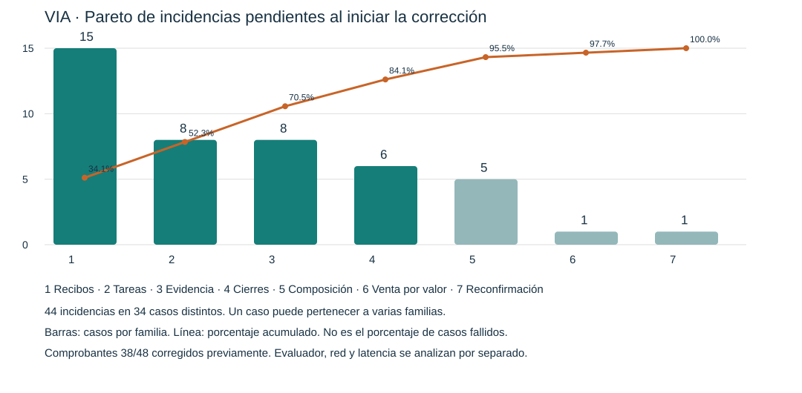

# Pareto y corrección de incidencias de los 50 casos

Fecha: 4 de noviembre de 2026. Alcance: análisis, correcciones y validación local. Sin commit, push, despliegue, mensajes reales de WhatsApp ni cambios a catálogos productivos.

## Base y método

Se conserva como evidencia histórica el [informe original](Resultado-50-casos-version-final-y-auditoria-2026-11-04.md). Sus 13 `passed` no equivalían a 13 conversaciones impecables: seis tenían defectos omitidos por el evaluador. Los 38/48 ya se corrigieron en la [iteración de comprobantes](Implementacion-avisos-comprobante-local-2026-11-04.md) y se excluyen del trabajo pendiente.

Unidad: **un caso afectado por una familia de incidencia funcional**. Un mismo caso puede aparecer en varias familias, pero solo una vez dentro de cada familia. Son **44 incidencias en 34 casos distintos**, no 44 conversaciones fallidas. Se incluyen las observaciones de experiencia 24 y contrato comercial 45, señaladas expresamente; no se afirma que todos los hallazgos tengan igual gravedad.

Se separan del denominador los defectos del evaluador, los siete acuses lentos (02/09/13/22/23/33/34) y los dos errores de conexión (03/17). Su frecuencia no se suma como si fueran fallos semánticos. El 17 conserva además la negativa incorrecta de catálogo, reproducida sin error de conexión.

| Familia | Casos afectados | Incidencias | % | Acumulado |
|---|---|---:|---:|---:|
| Recibo sin presentación / modalidad incoherente | 01,04,22,23,24,29,30,32,33,34,35,40,42,44,50 | 15 | 34,1% | 34,1% |
| Duplicación de tareas humanas | 17,18,28,37,39,46,47,49 | 8 | 18,2% | 52,3% |
| Evidencia insuficiente o afirmaciones sin respaldo | 06,10,11,14,17,27,42,50 | 8 | 18,2% | 70,5% |
| Cierre de consulta convertido en búsqueda o compra | 12,13,14,15,19,26 | 6 | 13,6% | 84,1% |
| Composición/fallback/transporte pierde información | 10,13,18,26,40 | 5 | 11,4% | 95,5% |
| Venta por valor con contrato insuficiente | 45 | 1 | 2,3% | 97,7% |
| Reconfirmación innecesaria | 24 | 1 | 2,3% | 100% |



[Datos del gráfico y casos](evidencias/pareto-incidencias-50-2026-11-04.json).

Las cuatro primeras familias concentran 84,1%. **No es una regla 80/20 exacta:** son cuatro de siete familias. La prioridad combina frecuencia y riesgo: integridad monetaria, consentimiento, aislamiento y pérdida de productos tienen precedencia aunque afecten a un solo caso.

## Causas y cambios de esta iteración

| Componente | Causa contrastada | Cambio |
|---|---|---|
| `agentRuntime.js`: confirmación | Reconstruía recibo solo con nombre, omitía presentación, resumía después de tres líneas y siempre hablaba de domicilio | Guarda presentación en el pedido; construye el recibo desde el resultado persistido y conserva todas las líneas. D corrige además la suposición de retiro: `delivery=false` solo acredita que no se incluyó domicilio. Sigue siendo un acuse transaccional con hechos comprometidos; no se presenta como otra decisión del LLM. |
| `toolRegistry.js`: handoff/aprobación | Cada llamada creaba UUID y tarea; descuento perdía el contexto estructurado | Reutiliza tarea abierta dentro del mismo tenant/conversación/tipo/acción/orden/gate. Conserva contexto previo y actualiza información. Permite necesidad distinta explícita del intérprete. Tarea resuelta y preparación de otro pedido siguen siendo independientes. |
| `semanticContracts.js`, `llmPlanner.js` | Intérprete no recibía identidad de gestiones abiertas; cierre heredaba contexto de búsqueda | Pasa tareas abiertas al LLM y conserva `humanTask` con referencia o necesidad nueva. Prompt distingue cierre, seguimiento, consulta y compra por contexto; no se incorporan listas de saludos ni palabras de despedida para enrutar. |
| `agentRuntime.js`: consulta | Sin productos interpretados fabricaba búsqueda con todo el texto | Un marco vacío se conserva como conversación contextual; no autoriza una búsqueda artificial. El LLM sigue interpretando el mensaje. |
| `groundingContracts.js`, coordinador y resolutor | Dos consultas priorizaban texto original antes que reformulaciones; resultados parciales podían interpretarse como inventario completo | Da espacio a variantes semánticas dentro del mismo presupuesto de búsquedas. Declara cobertura parcial al resolutor y composer; instruye reformular sin inventar ausencia global ni aceptar premisas del cliente contra evidencia. |
| `llmReplyComposer.js` | Atributos/promesas sin respaldo; límite previo distinto al transporte; fallback omitía opciones después de seis precios | Refuerza atribución a datos del catálogo y evita deducir datáfono de pago con tarjeta. Acepta hasta 4096 caracteres de texto; conserva todas las opciones con precio respaldado en fallback. |
| `agentRuntime.js`: transporte | `slice(0,1024)` cortaba productos/precios de respuestas interactivas | Si el cuerpo excede 1024, envía primero el texto completo y luego las opciones. Texto mayor de 4096 se divide sin descartar contenido. Cada envío conserva la comprobación de mensajes nuevos/atención manual. |
| Evaluador | Toda aserción fallida contaba como P0; subconjunto exigía 50 aprobados; unicidad dependía del título; fallback invisible | Separa P0 por severidad, identifica campaña completa, calcula aprobación del subconjunto ejecutado, compara identidad operacional y registra fallback de composición. Límite de turnos informativos requiere revisión, no se convierte automáticamente en éxito ni en defecto de VIA. |

No se cambió el algoritmo de similitud por reglas de marca, ni se amplió el catálogo para hacer pasar casos. No se añadieron rondas ni llamadas normales al LLM: siguen intérprete → resolutor acotado → composer. Un mensaje largo puede requerir más de un envío simulado; se medirá por separado de una respuesta lógica.

## Validación y trazabilidad

Antes de corregir, `server/tests/pareto-regression-contract.mjs` reprodujo cinco fallos: tarea genérica duplicada, preparación repetida, descuento duplicado/sin contexto, búsqueda fabricada y precio cortado. Después pasaron las seis pruebas, incluida la separación de nuevas necesidades, tenants y tareas resueltas.

Se añadieron comprobaciones de presentación persistida/recibo y unicidad independiente del título. Pasaron los contratos de arquitectura, domicilios, grounding, aceptación y comprobantes; también los 50 escenarios mock de Colombia (60 pasos). Estos últimos **no prueban comprensión de DeepSeek**.

La regresión de comprobantes en PostgreSQL local pasó sus diez comprobaciones. No verificó dinero ni condicionó la compra o despacho.

Campaña nueva: `test-results/pareto-final50`, orquestada por `test-results/run-pareto50.mjs`. Ejecuta los mismos 50 escenarios, cuatro clones locales, DeepSeek real y Meta/Google simulados. Registra huellas de fuentes antes/después y compara la base original. Los artefactos bajo `test-results/` están ignorados por Git; no se presupone que sean accesibles en remoto.

### Campaña A: 50 casos, fuentes congeladas

Terminó con huellas de fuentes y base PostgreSQL original sin cambios. DeepSeek real; WhatsApp y Google simulados; ninguna salida no autorizada. [Resumen verificable por caso](evidencias/pareto-repeticion-50-2026-11-04.json), [artefactos locales](../test-results/pareto-final50/pareto-audit.json).

| Resultado automático | Informe anterior | Campaña A |
|---|---:|---:|
| Aprobado | 13 | 24 |
| Fallo funcional | 17 | 7 |
| Requiere revisión | 16 | 13 |
| Error del evaluador | 2 | 3 |
| Error de infraestructura | 1 | 0 |
| Fallback de integración | 1 | 3 |
| Total | 50 | 50 |

No es una tasa causal de mejora: cambió el instrumento para hacer visibles fallbacks y diferenciar revisión; el comprador y juez generan diálogos variables. Los **24/50** no equivalen a 48% de capacidad productiva. Tampoco se considera corregido el 84,1% por haber intervenido cuatro familias.

Evidencia objetiva:

- **Cero casos con tareas humanas duplicadas**, frente a ocho identificados en el informe anterior. La unicidad ya no depende del título de la tarjeta.
- **14 de 14 pedidos con presentación en el recibo**; los 14 completaron el flujo del tendero. El informe anterior tenía 15 recibos sin presentación. La diferencia de pedidos creados no se convierte en mejora ni regresión sin analizar el actor.
- Ninguna aserción técnica P0 de integridad falló. Esto no descarta errores semánticos ni basta para aprobar producción.
- De los siete `failed_functional`, **04/13/22/33/50 fallan solo por acuses lentos**. El 46 pierde la foto al crear la tarea en un turno posterior. El 24 combina comprador/juez que cuestionan indebidamente tarifa cero con una contradicción posterior real de VIA.
- **05/17/29** registraron fallback. El 05 había cerrado la consulta pero el composer copió un precio histórico no respaldado en ese turno; el 17 perdió preguntas de combos/sabores en el fallback; el 29 omitió desglose de confirmación y utilizó el acuse seguro.
- El juez de **29/32** exige verificar efectivo e incluso contradice su propia cita de aceptación. No se atribuye eso a VIA ni se suprimen sus demás hallazgos. Los errores de citas/SKU en 02/27/32 también requieren revisión, no una aprobación automática.

### Segunda corrección, a partir de las trazas A

1. **Foto anterior, gestión posterior:** `toolRegistry.js` conserva referencias reales de adjuntos de la misma conversación y tenant, aunque el mensaje actual sea texto. No interpreta píxeles ni convierte la foto en comprobante. El último mensaje y el adjunto quedan en campos distintos.
2. **Cierre contextual:** `semanticContracts.js` admite `conversationAct=close`, decidido por el intérprete. El composer no debe copiar precios históricos al despedirse; su fallback conserva el cierre y la tarea pendiente. `agentRuntime.js` mantiene zona/estado/siguiente paso de atención humana.
3. **Falta de sujeto de búsqueda:** se conserva `catalogSearchReady`, emitido por el LLM. Si es falso, se solicita aclaración contextual sin buscar una palabra genérica ni crear escalamiento por resultados inexistentes. No se decide por una lista de palabras; categoría, ocasión o producto con errores siguen permitiendo búsqueda.

Las cuatro nuevas regresiones fallaron antes y pasaron después. La repetición B ejecutó 13 escenarios con DeepSeek real en `test-results/pareto-focused-b`, conservando fuentes y base original. **05 y 46 pasaron**, al igual que 26/38/47/48. El 14 sufrió `fetch failed` del intérprete: no se presenta como error semántico ni como éxito. El 41 aún mostró que el modelo podía omitir la señal de alcance, por lo que se hizo explícita en el contrato solicitado al modelo para la siguiente iteración.

### Tercera corrección y validación focalizada

- **Acuse webhook:** una prueba controlada con PostgreSQL real reprodujo que `enqueueInboundMessage` esperaba un guardado ajeno en `saveQueue` (533 ms hasta liberar una barrera de 500 ms). Las tablas `inbound_messages` e `integration_outbox` no son espejos de `app_state`; ahora su inserción atómica tiene seguimiento independiente. Se conserva COMMIT antes del ACK, deduplicación por identificador y espera de escrituras en `flush`. No se cambió el DDL ni se eludió persistencia. Las cuatro pruebas de prioridad, 16 redeliveries concurrentes, rollback y flush pasan. Esto demuestra el bloqueo y su corrección local; no atribuye por sí solo todos los tiempos históricos de producción a esa causa.
- **Consulta humana perdida:** cuando los productos estaban resueltos pero el resolutor elegía `nextAction=human_review` para consultar IVA u otra condición, el runtime solo atendía las resoluciones de producto y omitía abrir la tarea. Ahora respeta esa decisión del LLM y conserva la pregunta exacta. Una regresión reprodujo el fallo y pasó después.
- **Costo del contexto:** se elimina la copia redundante de `candidateSet` dentro de cada resolución enviada al composer. Se mantienen completos los candidatos, descripciones y atributos en su sección de evidencia; las resoluciones referencian SKU. No se recortan campos para abaratar a costa de comprensión.

Campaña C finalizada: **8 aprobados, 4 en revisión y 1 fallo funcional, de 13 casos**. Cinco pedidos con presentación y flujo del tendero completo; sin tareas duplicadas ni fallbacks; cero ACK de un segundo o más. Se conservaron las huellas de fuentes durante la campaña y la base original. **Los 50 casos corresponden a A, no a C.**

| Casos C | Resultado y auditoría |
|---|---|
| 04,05,14,15,17,24,46,50 | `passed`. 04/50 ya no fallan por ACK; 15 conserva la decisión de consulta humana; 46 mantiene la foto anterior. Los diálogos variables no prueban que toda variante histórica esté resuelta. |
| 16 | `needs_review` por límite de tres turnos. Auditoría confirma un defecto real: primero dice «tenemos varias bebidas frías» sin evidencia de refrigeración. Luego aclara y conserva una sola gestión humana; esa corrección posterior no borra el error inicial. |
| 27 | `needs_review` por tres turnos. En esta repetición sí recuperó y cotizó Yogo Yogo mora 150 g y Nucita crema 35 g tras refinar la consulta. Falta validar cierre; no sustituye el diálogo incompleto de A por un éxito. |
| 33 | `needs_review`: pedido y total creados, pero el juez asigna precio a una cita que no lo contiene. Su observación sobre cantidad también necesita contrastarse con la canasta; se conserva revisión. |
| 41 | `needs_review` por dos turnos. Saludó, pidió productos y respondió sobre dirección/pago sin inventar búsqueda ni crear tarea humana. El caso termina por límite del simulador, no por una búsqueda fallida. |
| 22 | Fallo real: el recibo anunció «Retiro en tienda» sin elección expresa del cliente. Generó la corrección D. |

### Cuarta corrección: modalidad y etiquetas

`delivery=false` también representa ausencia de solicitud de domicilio; no prueba que el comprador eligiera recogida. El recibo y el resumen al tendero ahora informan «sin domicilio incluido» y coordinación pendiente, sin imponer recogida. Esto corrige la afirmación; **no implementa una nueva modalidad comercial ni resuelve el modelo trivalente entrega/recogida/por definir**.

Los títulos cortos de opciones ya no incluyen importes que Meta pueda cortar a 20/24 caracteres. El cuerpo conserva el precio completo; la selección conserva su ID y SKU. Nombres de variantes muy largos aún requieren mejorar su identificación visual.

Ambas regresiones fallaron antes y pasaron después. D repitió 22/24 con fuentes congeladas: 22 terminó el pedido pero quedó `integration_fallback` por `fetch failed` del intérprete inicial; 24 quedó `failed_functional` por una reconfirmación real. El comentario del juez que exige acreditar el efectivo es inválido para el alcance de VIA. D produjo dos pedidos completos, sin ACK lento. En 22 hay una tarea de ayuda y otra de preparación: **dos tareas de acciones distintas no son una duplicación**; queda revisar la vigencia de la ayuda inicial tras completar el pedido.

### Quinta corrección: aceptación contextual de una cotización comunicada

La traza D/24 identifica el origen de la reconfirmación: el intérprete ya devolvía `order_confirmation`, pero el runtime exigía `pendingQuestion.kind=confirmation`. La respuesta previa había comunicado productos, subtotal, domicilio y total como respuesta informativa (`customer_question`). El backend descartaba esa aceptación válida.

- `llmReplyComposer.js` expone una comprobación del desglose usando los mismos hechos monetarios tipados y etiquetas que ya valida. No interpreta intención ni busca palabras de confirmación.
- `agentRuntime.js` guarda `communicatedQuote` solo tras aceptación del envío por el proveedor, sin pendientes comerciales/humanos, con desglose completo y versión de canasta vigente. Registra versión, revisiones de canasta/política, total, modalidad y referencia del envío. No equivale a confirmación de lectura del cliente.
- Una decisión contextual `order_confirmation` puede aceptar esa misma cotización aunque la pregunta anterior fuera informativa. Cambios de canasta, política, importe o versión, envío suprimido, falta de desglose y productos pendientes siguen impidiendo el cierre. No se infiere consentimiento a partir de precios mencionados por el comprador.
- Se conserva la compatibilidad del flujo existente de botones. No se añadieron llamadas al LLM ni migraciones de base de datos.

La regresión de reconfirmación falló antes y pasó después. También pasan los controles negativos de respuesta parcial, envío suprimido y cambio posterior de tarifa.

La campaña E (22/24/29) terminó con **1 `passed`, 1 `evaluator_error` y 1 `failed_functional` automático**; no se reescriben esos estados:

- **22 aprobó**. Conservó tres productos, presentaciones y total $16.500; el recibo ya no inventó recogida. El catálogo se consultó por todas las líneas y se conservaron sus selecciones.
- **24:** el comprador automático terminó después de recibir una cotización correcta, antes de enviar aceptación. Es un error del evaluador y no valida el camino de reconfirmación.
- **29:** el juez exige acreditar efectivo, contradiciendo el alcance explícito. El cliente aporta nombre, dirección y efectivo en turno 4 y acepta en turno 5; el pedido conserva esos datos y total $7.200. El fallo P1 automático no acredita un defecto de pago de VIA. Sí hay una observación UX independiente: el catálogo de prueba contiene dos referencias de Coca-Cola 1.5 L con distintos precios; deben distinguirse con atributos, no eliminar una por conveniencia del test.

Las capturas de PostgreSQL de los tres casos conservan `communicatedQuote`, verificando su persistencia sin migración. Fuentes congeladas y base original sin cambios; cero fallback, cero ACK >=1 s y dos pedidos con presentación completa. Se mantiene `readyForPilot=false`.

Para verificar el camino que el actor abandonó, se añadió [replay dirigido de consentimiento](../scripts/e2e/verify-pareto-quote-consent.mjs). Usa un comprador con cuatro mensajes fijos, **intérprete/resolutor/composer DeepSeek reales**, almacenamiento local temporal y transportes simulados. Es una prueba de integración del runtime, no sustituye el E2E webhook/PostgreSQL.

**Resultado: aprobado, 4 turnos, 10 llamadas, 55.203 tokens, sin fallback.** El turno 3 conserva `pendingQuestion=customer_question` y registra el desglose enviado; el turno 4 interpreta aceptación y crea una sola orden por $9.700, sin reconfirmar. Conserva yogurt 150 g, galletas 12 unidades, domicilio y efectivo. Huellas de fuentes sin cambios. [Evidencia completa local](../test-results/pareto-consent-replay/2026-11-04T23-18-11-176Z/report.json).

[Resultados conservados de B/C/D/E y replay](evidencias/pareto-repeticiones-focalizadas-2026-11-04.json). Estas son repeticiones separadas; no se suman sus mejores resultados para inventar una aprobación de los 50 sobre la versión final.

## Rendimiento y consumo medidos

| Medida | Campaña anterior | A |
|---|---:|---:|
| Turnos de comprador | 168 | 175 |
| ACK p50 / p95 | 14 / 41 ms | 12 / 2.222 ms |
| ACK >= 1 s | 7 | 11 |
| Primera respuesta p50 / p95 | 6.586 / 10.354 ms | 6.450 / 10.943 ms |
| Primera respuesta máxima | 12.582 ms | 19.406 ms |
| Llamadas VIA | 466 | 491 |
| Tokens VIA entrada / salida | 1.715.416 / 109.727 | 2.521.544 / 124.356 |
| Tokens VIA totales | 1.825.143 | 2.645.900 |

El consumo de A **aumentó 45,0%**, con 4,2% más turnos. Añadir evidencia al composer sí tiene costo aunque no se añadan etapas al flujo. Se encontró duplicación de candidatos dentro del prompt y se eliminó en C; todavía no se presenta una reducción mensual como medida ni se extrapola a producción. Juez y comprador son costo de evaluación: A usó respectivamente 49 llamadas/2.959.556 tokens y 124 llamadas/253.052 tokens, separados de VIA.

En C se midieron 45 turnos, 126 solicitudes de VIA y 583.891 tokens (555.088 de entrada / 28.803 de salida). ACK p50/p95 **13/29 ms**, máximo 38 ms. Primera respuesta p50/p95 **5.465/12.308 ms**, máximo 14.413 ms. El aislamiento de persistencia mejora el acuse, pero **no elimina la latencia del razonamiento**. La muestra C y sus diálogos son distintos a A: no se atribuye una reducción de costo por pedido a partir de sus promedios.

## Límites pendientes

- La venta por valor del 45 necesita un contrato comercial verificable. Un presupuesto no demuestra autorización para fraccionar un producto.
- La corrección de reconfirmación del 24 debe repetirse con cambios de canasta, consentimiento tardío y cotizaciones concurrentes. Los contratos de integridad no sustituyen varias conversaciones reales.
- Los acuses lentos históricos de producción aún necesitan atribución entre contención/PostgreSQL/harness. La prueba causal local y C no sustituyen una prueba de carga.
- Las mejoras de prompts requieren auditoría de salidas reales: un `passed` del juez no demuestra por sí solo ausencia de invenciones.
- Las gestiones humanas distintas y simultáneas deben seguir distinguiéndose por contexto; no basta deduplicar por título ni suponer que dos títulos son dos necesidades.

## Siguiente prioridad, sin declarar cierre general

| Prioridad | Hallazgo abierto | Criterio de cierre |
|---|---|---|
| Alta | 12/16: atributos de producto o estado operativo sin evidencia | El resolutor/composer debe separar atributo acreditado de hipótesis semántica; pruebas negativas de temperatura, ingredientes y logística. El LLM elige aclarar o consultar; no un diccionario de palabras. |
| Alta | 45: presupuesto interpretado como fracción vendible | Acreditar unidad de venta y autorización de fraccionamiento por tenant; sin evidencia, conservar necesidad y consultar al humano sin inventar cantidad. |
| Alta | Evaluador: citas no literales, confusión de precio/importe y exigencia de verificar efectivo | Revisar contra conversación, canasta y rúbrica; una cita inválida produce revisión, nunca un parche para validar pagos fuera de alcance. |
| Media | 17/27: preguntas múltiples y búsquedas progresivas; 49: pregunta de cantidad ya resuelta | Reproducir los diálogos concretos, conservar todas las necesidades y comprobar referencias de línea; no dar por resuelto por otra conversación aprobada. |
| Media | Latencia de respuesta y fallos transitorios del proveedor | Desglose por etapa y concurrencia con presupuesto acotado; no sumar retries indefinidos ni confundir ACK con respuesta al comprador. |
| Media | Entrega/recogida/por definir y ayuda pendiente tras crear pedido | Contrato explícito de modalidad y ciclo de vida humano, interpretado por LLM, antes de afirmar logística. |

Pruebas locales de la iteración: 12 regresiones Pareto, 14 contratos runtime de domicilio, 31 contratos de composición, 7 de continuidad de canasta, 12 suites de arquitectura y 4 comprobaciones PostgreSQL de prioridad/atomicidad, además de las campañas con DeepSeek real. Los 50 escenarios completos todavía requieren una nueva corrida sobre la última versión y repeticiones críticas antes de considerar el piloto listo. No se cambió producción.

## Reproducción y estado de entrega

Contratos sin credenciales:

```powershell
node server/tests/pareto-regression-contract.mjs
node server/tests/delivery-runtime-contract.mjs
node server/tests/llm-reply-composer-contract.mjs
npm run test:cart-continuity
npm run test:architecture
```

Con `POSTGRES_TEST_DATABASE_URL` apuntando explícitamente a PostgreSQL local: `node server/tests/inbound-persistence-priority.mjs`. Crea y elimina únicamente su esquema temporal; no opera sobre las tablas existentes del desarrollo.

Con `DEEPSEEK_API_KEY` configurada localmente y sin `LLM_SIMULATOR`: `node scripts/e2e/verify-pareto-quote-consent.mjs`. Solo permite salida de red a DeepSeek, limita a 30 llamadas y deja evidencias en `test-results/pareto-consent-replay/`. No almacena ni imprime la credencial.

Campañas E2E: el ejecutor mantenido es `server/tests/run-contextual-e2e.mjs`; usa `E2E_CASE_IDS`, `E2E_SOURCE_DATABASE_URL` local y un `E2E_RESULT_DIR` nuevo para repetir. Los orquestadores A–E y sus hashes quedaron en `test-results/`, ignorado por Git. Los resúmenes verificables quedaron en `docs/evidencias/`. Se preservaron los cambios previos del repositorio. **Sin commit, push ni despliegue.**

La continuación solicitada para identificar y corregir las causas está en [Causas y correcciones](Causas-y-correcciones-Pareto-2026-11-04.md). Conserva esta auditoría histórica y registra las nuevas campañas por separado.

## Actualización posterior: correcciones causales M/N/O/P

El [estado consolidado de las correcciones](Causas-y-correcciones-Pareto-2026-11-04.md#estado-consolidado-de-esta-intervención) contiene la evidencia más reciente. Las prioridades y cifras anteriores son históricas: la campaña completa L alcanzó 41/50 aprobados automáticos; las correcciones posteriores se verificaron en repeticiones focalizadas con distintas huellas de fuentes y no equivalen a 50/50 sobre una misma versión.

Se corrigieron duplicación de líneas, continuidad tras timeout, conservación de domicilio, consultas y cotizaciones, además de errores del simulador/juez. El caso 45 conserva ambos productos y una única gestión humana, sin pedido incompleto ni pregunta de pago prematura; todas sus aserciones funcionales y de integridad pasan. Mantiene `integration_fallback` porque se rechazó un importe no fundamentado en el acuse final y se envió una respuesta segura. Quedan por verificar robustez de esa redacción, campaña completa final y carga. Toda esta intervención y sus pruebas fueron locales; la base de origen quedó sin cambios y no se desplegó.
